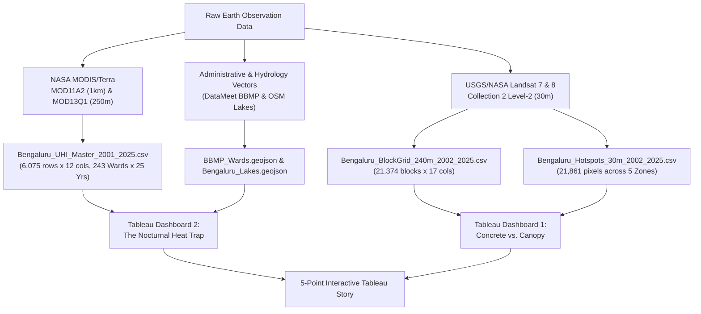
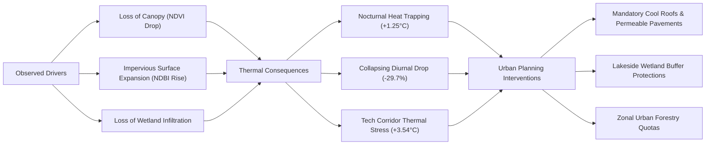

# BENGALURU URBAN HEAT ISLAND (UHI) — THERMAL SHIFT (2001–2025)
## Visualizing How Rapid Urbanization and Canopy Loss Drive Daytime and Nighttime Heat Islands Across Bengaluru
**Academic Course:** Sem 5 — Data Visualization Project Report  
**Authors:** Student Team (Person 1 & Person 2)  
**Tools & Platforms:** Tableau Public / Desktop, Python (Pandas, GeoPandas, Scipy, Tifffile), NASA MODIS Terra, USGS Landsat 7/8 Collection 2 Level-2  

---

## 1. Executive Summary & Abstract

Over the past quarter-century (2001–2025), Bengaluru transformed from India's lush "Garden City" into the high-density "Silicon Valley of Asia." While economic and demographic expansion fueled massive infrastructural growth, it profoundly altered the regional microclimate. 

This project delivers a multi-resolution, multi-temporal visual and statistical investigation of Bengaluru's **Urban Heat Island (UHI)** effect. Using 25 years of NASA MODIS Terra satellite observations across all **243 BBMP wards ($704.1\text{ km}^2$)**, high-resolution **240m Landsat block grids (21,374 blocks)**, and pure **30m building-scale pixels (21,861 pixels)** across 5 economic corridors, this report presents empirical proof of urban thermal modification.

### Core Discoveries:
1. **The Nocturnal Heat Trap Paradox:** City-wide summer mean nighttime Land Surface Temperature (LST) rose at **$+0.81^\circ\text{C}$ per decade** ($p = 0.00016, R^2 = 0.47$), jumping from $23.72^\circ\text{C}$ (2001–05) to $24.97^\circ\text{C}$ (2021–25).
2. **Collapsing Diurnal Cooling:** The overnight cooling drop ($\text{Day LST} - \text{Night LST}$) plummeted by **$-1.86^\circ\text{C}$ per decade** ($p = 1.36 \times 10^{-8}, R^2 = 0.76$), representing a **$-29.7\%$ loss** in nocturnal heat dissipation capacity.
3. **The Construction-to-Heat Jump:** At the 240m block scale, land parcels transitioning from **"Green $\to$ Concrete"** experienced an intense relative UHI jump of **$+6.36^\circ\text{C}$** ($\Delta\text{NDVI} = -0.23, \Delta\text{NDBI} = +0.15$), while urban densification accounted for a **$+5.16^\circ\text{C}$** jump.
4. **The Tech Corridor Thermal Penalty:** At 30m resolution, Manyata Tech Park registered an April 2025 surface temperature of $40.61^\circ\text{C}$, imposing a **$+3.54^\circ\text{C}$ thermal penalty** over the central ecological benchmark of Cubbon Park ($37.07^\circ\text{C}$).

---

## 2. Dataset Architecture & Preprocessing Pipeline

The analytical foundation rests on four curated, verified datasets integrated across administrative and spatial scales:



### Table 1: Comprehensive Dataset Specifications

| Dataset Name | Source Sensor | Spatial Extent / Resolution | Temporal Coverage | Records & Features | Primary Metrics |
|---|---|---|---|---|---|
| `Bengaluru_UHI_Master_2001_2025.csv` | NASA MODIS Terra | 243 BBMP Wards (1 km LST / 250m VI) | 2001–2025 (Annual Summer Means) | 6,075 rows × 12 cols (0 nulls) | `Day_LST_C`, `Night_LST_C`, `Cooling_Drop_C`, `Mean_NDVI`, `Mean_NDBI`, `Night_UHI_Anomaly_C` |
| `Bengaluru_BlockGrid_240m_2002_2025.csv` | USGS Landsat 7/8 C2 L2 | 240m × 240m Grid Cells | April 2002, 2015, 2025 | 21,374 rows × 17 cols | `LST_2002_C`, `LST_2025_C`, `Delta_LST_C`, `Delta_NDVI`, `Delta_NDBI`, `Land_Transition` |
| `Bengaluru_Hotspots_30m_2002_2025.csv` | USGS Landsat 7/8 C2 L2 | Pure 30m × 30m Pixels | April 2002, 2015, 2025 | 21,861 rows × 16 cols | 5 Zones (Bellandur, Whitefield, Manyata, Electronic City, Cubbon Park) |
| `BBMP_Wards.geojson` | DataMeet Municipal | 243 Municipal Boundaries ($704.1\text{ km}^2$) | Current delimitation | 243 polygon features | `KGISWardNo`, `KGISWardName`, geometry |
| `Bengaluru_Lakes.geojson` | OpenStreetMap Overpass | 1,981 Waterbodies ($51.38\text{ km}^2$) | Current hydrographic | 1,981 features (285 named) | `name`, `water_type`, polygon geometry |

---

## 3. Exploratory Data Analysis & Statistical Formulations

### 3.1 Mathematical Definitions

- **Normalized Difference Vegetation Index (NDVI):**
  $$\text{NDVI} = \frac{\rho_{\text{NIR}} - \rho_{\text{Red}}}{\rho_{\text{NIR}} + \rho_{\text{Red}}}$$
- **Normalized Difference Built-Up Index (NDBI):**
  $$\text{NDBI} = \frac{\rho_{\text{SWIR}} - \rho_{\text{NIR}}}{\rho_{\text{SWIR}} + \rho_{\text{NIR}}}$$
- **Diurnal Cooling Drop:**
  $$\Delta T_{\text{cooling}} = T_{\text{Day LST}} - T_{\text{Night LST}}$$
- **UHI Anomaly:**
  $$\text{UHI}_{\text{anomaly}, i, t} = T_{\text{LST}, i, t} - \mu(T_{\text{LST}, t})$$

### 3.2 Correlation & Transition Dynamics
- **Impervious Built-Up Heating:** Pearson correlation between ward built-up density (`Mean_NDBI`) and daytime surface temperature is strongly positive ($r = +0.636$).
- **Vegetation Cooling Effect:** Correlation between canopy density (`Mean_NDVI`) and nighttime UHI anomaly is strongly negative ($r = -0.565$).
- **ANOVA Significance of Transitions:** One-way ANOVA testing thermal shift ($\Delta\text{LST}$) across the 6 land transition classes yielded $F = 711.74$ ($p < 10^{-15}$), rejecting the null hypothesis and proving that physical canopy displacement by concrete drives localized warming.

---

## 4. Tableau Dashboard Architecture & Visualization Guide

The visualization deliverables are organized into two synchronized interactive dashboards and a cohesive 5-point Tableau Story.

---

### Dashboard 1: Concrete vs. Canopy (240m Block & 30m Building-Scale)
*Focus: Micro-urban spatial shifts, construction thermal jumps, and building-level case studies.*

```
+---------------------------------------------------------------------------------------------------+
|  [ PLACEHOLDER: DASHBOARD 1 FULL OVERVIEW SCREENSHOT ]                                            |
|                                                                                                   |
|  * Instructions: Take a full-screen capture of "Dashboard 1 - Concrete vs Canopy" in Tableau.     |
|  * Features to capture: 240m map on the left, Bar Chart top-right, Scatter/30m zoom bottom-right. |
|  * File to save: dashboard1_concrete_vs_canopy_full.png                                          |
+---------------------------------------------------------------------------------------------------+
```
*Figure 4.1: Dashboard 1 — Comprehensive layout demonstrating the micro-scale thermal penalty of land cover transitions across Bengaluru.*

---

#### Sheet 1: 240m Micro-Block Heat Map
- **Visual Encoding:** Mark type = `Square` (Size adjusted to form a continuous grid); Color = `Delta_UHI_C` (Diverging Red-Blue palette, center = 0.0); Overlay = `Bengaluru_Lakes.geojson` cyan marks layer.
- **Narrative Function:** Displays all 21,374 parcels across Bengaluru, revealing the peripheral belt of intense warming along the Outer Ring Road, Whitefield, and North Bengaluru.

```
+---------------------------------------------------------------------------------------------------+
|  [ PLACEHOLDER: SHEET 1 - 240M HEAT MAP SCREENSHOT ]                                              |
|                                                                                                   |
|  * Instructions: Capture the 240m tiled heat map sheet with Satellite/Dark background map.        |
|  * Details visible: Tiled squares colored by Delta UHI, lake overlays in cyan, legend on right.    |
|  * File to save: sheet1_240m_heat_map.png                                                         |
+---------------------------------------------------------------------------------------------------+
```
*Figure 4.2: Sheet 1 — High-resolution 240m block-grid map showing spatial distribution of thermal shifts (2002–2025).*

---

#### Sheet 2: Heat Jump by Land Transition (Proof Bar Chart)
- **Visual Encoding:** Rows = `Land Transition`; Columns = `AVG(Delta UHI C)`; Color = `AVG(Delta UHI C)`; Labels = Custom `+0.0°C;-0.0°C`.
- **Narrative Function:** Proves that *"Newly Built-Up (Green $\to$ Concrete)"* jumped **$+6.36^\circ\text{C}$** and *"Urban Densification"* jumped **$+5.16^\circ\text{C}$**, while *"Persistent Green"* remained cool at **$-0.59^\circ\text{C}$**.

```
+---------------------------------------------------------------------------------------------------+
|  [ PLACEHOLDER: SHEET 2 - HEAT JUMP BAR CHART SCREENSHOT ]                                        |
|                                                                                                   |
|  * Instructions: Capture the horizontal bar chart sorted descending by average thermal jump.     |
|  * Details visible: Ranked transition classes, red diverging bars, bold degree labels on bars.    |
|  * File to save: sheet2_heat_jump_by_transition.png                                               |
+---------------------------------------------------------------------------------------------------+
```
*Figure 4.3: Sheet 2 — Empirical proof of temperature increase categorized by satellite-classified land transition.*

---

#### Sheet 3: 30m Hotspot Zoom (Pure Building-Scale Pixels)
- **Visual Encoding:** Marks = `Square` (75% opacity); Background = Mapbox Satellite; Dropdown filter = `Zone` (e.g. `Bellandur_ORR_Ecospace`).
- **Narrative Function:** Zooms directly to individual tech parks (Ecospace, RMZ Infinity, ITPL), showing exact thermal emissions from glass roofs and parking structures.

```
+---------------------------------------------------------------------------------------------------+
|  [ PLACEHOLDER: SHEET 3 - 30M HOTSPOT ZOOM SCREENSHOT ]                                           |
|                                                                                                   |
|  * Instructions: Capture the 30m pixel grid zoomed into Bellandur / ORR over satellite imagery.   |
|  * Details visible: Tech park footprints visible beneath raw 30m thermal anomaly squares.         |
|  * File to save: sheet3_30m_hotspot_zoom.png                                                      |
+---------------------------------------------------------------------------------------------------+
```
*Figure 4.4: Sheet 3 — Native 30m Landsat thermal resolution isolating individual corporate campuses.*

---

#### Sheet 4: Tree Loss vs. Heat Scatter (Correlation Proof)
- **Visual Encoding:** Columns = `Delta NDVI`; Rows = `Delta UHI C`; Disaggregate Measures = Enabled; Trend Line = Linear OLS; Color = `Delta NDBI`.
- **Narrative Function:** Validates the physical law of urban climatology: canopy depletion directly precipitates localized thermal amplification ($r = -0.57$).

```
+---------------------------------------------------------------------------------------------------+
|  [ PLACEHOLDER: SHEET 4 - TREE LOSS VS HEAT SCATTER SCREENSHOT ]                                  |
|                                                                                                   |
|  * Instructions: Capture the 21,861 unaggregated pixel scatter plot with linear trendline.        |
|  * Details visible: Downward-sloping trendline, dense point cloud colored by built-up index.      |
|  * File to save: sheet4_tree_loss_vs_heat_scatter.png                                             |
+---------------------------------------------------------------------------------------------------+
```
*Figure 4.5: Sheet 4 — Scatter plot demonstrating the inverse relationship between canopy change and surface heat.*

---

### Dashboard 2: The Nocturnal Heat Trap (2001–2025)
*Focus: 25-year longitudinal trend, nocturnal heat retention, and ward-level rankings.*

```
+---------------------------------------------------------------------------------------------------+
|  [ PLACEHOLDER: DASHBOARD 2 FULL OVERVIEW SCREENSHOT ]                                            |
|                                                                                                   |
|  * Instructions: Capture the full "Dashboard 2 - Nocturnal Heat Trap" canvas.                    |
|  * Layout visible: 3 KPI cards on top, animated choropleth map on left, dual trend & ranking right.|
|  * File to save: dashboard2_nocturnal_heat_trap_full.png                                          |
+---------------------------------------------------------------------------------------------------+
```
*Figure 4.6: Dashboard 2 — Executive view illustrating the collapse in nocturnal cooling across Bengaluru's 243 wards.*

---

#### Executive KPI Cards (Top Banner)
- **Visual Encoding:** 3 modular cards distributed evenly in a Horizontal Container.
  - Card 1: `▲ +1.25°C` (Nighttime LST Rise)
  - Card 2: `▼ −29.7%` (Overnight Cooling Collapse)
  - Card 3: `▲ +6.36°C` (New Construction Jump)

```
+---------------------------------------------------------------------------------------------------+
|  [ PLACEHOLDER: EXECUTIVE KPI BANNER SCREENSHOT ]                                                 |
|                                                                                                   |
|  * Instructions: Capture the top horizontal container containing the 3 styled KPI cards.         |
|  * Details visible: Large bold typography, clear metric hierarchy, contrasting red/orange accents.|
|  * File to save: kpi_executive_banner.png                                                         |
+---------------------------------------------------------------------------------------------------+
```
*Figure 4.7: Executive headline KPI cards summarizing 25-year city-wide macro shifts.*

---

#### Sheet 5: 25-Year Nighttime Heat Trap (Dual-Axis Trajectory)
- **Visual Encoding:** Columns = `Year` (Continuous); Rows = `AVG(Night LST C)` (Red Line) and `AVG(Cooling Drop C)` (Blue Area / Line); Dual Axis = Enabled (Unsynchronized); Trend Line = Linear.
- **Narrative Function:** Highlights the widening scissors graph: nighttime baseline heat climbs while the cooling drop steadily shrinks.

```
+---------------------------------------------------------------------------------------------------+
|  [ PLACEHOLDER: SHEET 5 - DUAL-AXIS TRENDLINE SCREENSHOT ]                                        |
|                                                                                                   |
|  * Instructions: Capture the dual-axis chart showing 2001-2025 trends for Night LST and Drop.     |
|  * Details visible: Rising red line, falling blue line/area, linear trendlines with slopes.       |
|  * File to save: sheet5_dual_axis_trendlines.png                                                  |
+---------------------------------------------------------------------------------------------------+
```
*Figure 4.8: Sheet 5 — 25-Year dual-axis time series depicting the progressive erosion of nocturnal cooling capacity.*

---

#### Sheet 6: Animated Ward Night UHI Map (2001 $\to$ 2025 Time-Lapse)
- **Visual Encoding:** Geometry = BBMP Ward Polygons; Detail = `KGISWardName`; Color = `AVG(Night UHI Anomaly C)` (Temperature Diverging: $-2.5^\circ\text{C}$ to $+2.0^\circ\text{C}$); Pages Shelf = `Year`.
- **Narrative Function:** Allows the evaluator to press **Play (▶)** and observe the spatial expansion of nocturnal heat from the old industrial west toward the eastern tech corridor.

```
+---------------------------------------------------------------------------------------------------+
|  [ PLACEHOLDER: SHEET 6 - ANIMATED WARD CHOROPLETH SCREENSHOT ]                                   |
|                                                                                                   |
|  * Instructions: Capture the ward choropleth map on Dark background with the Pages play slider.   |
|  * Details visible: Colored ward boundaries, playback slider paused on year 2025, dark map styling|
|  * File to save: sheet6_animated_ward_map.png                                                     |
+---------------------------------------------------------------------------------------------------+
```
*Figure 4.9: Sheet 6 — Ward-level chloropleth map featuring the Pages shelf playback control.*

---

#### Sheet 7: Warming Wards Ranking (Top 15 Hottest Wards)
- **Visual Encoding:** Rows = `KGISWardName`; Columns = `AVG(Night LST C)`; Filter = Top 15 by `Night LST C`; Color = `AVG(Mean NDVI)` (Green-Red Diverging Reversed); Label = Temperature.
- **Narrative Function:** Identifies wards enduring the highest absolute nighttime thermal stress (Marathahalli, Hegganahalli, Peenya, Rajagopal Nagar).

```
+---------------------------------------------------------------------------------------------------+
|  [ PLACEHOLDER: SHEET 7 - WARD RANKINGS BAR CHART SCREENSHOT ]                                    |
|                                                                                                   |
|  * Instructions: Capture the Top 15 ranked horizontal bar chart colored by vegetation index.     |
|  * Details visible: Sorted ward names, red-to-green bar gradients, precise temperature labels.     |
|  * File to save: sheet7_warming_wards_ranking.png                                                 |
+---------------------------------------------------------------------------------------------------+
```
*Figure 4.10: Sheet 7 — Ranked horizontal bar chart identifying wards with peak nighttime heat retention.*

---

## 5. The 5-Point Tableau Story Mode Walkthrough

```
+---------------------------------------------------------------------------------------------------+
|  [ PLACEHOLDER: TABLEAU STORY MODE FULL SCREENSHOT ]                                              |
|                                                                                                   |
|  * Instructions: Capture the final Tableau Storybook showing Story Point 1 with top tabs.         |
|  * Details visible: Story navigation bar across the top with 5 narrative captions.                |
|  * File to save: story_mode_overview.png                                                          |
+---------------------------------------------------------------------------------------------------+
```
*Figure 5.1: The 5-Point Tableau Story providing a guided visual narrative of Bengaluru's thermal evolution.*

### Story Structure & Narrative Architecture:
1. **Story Point 1: The Hook (Nighttime Heat Trap)**
   - *Active Visual:* `Sheet 5: 25-Year Nighttime Heat Trap`
   - *Key Takeaway:* Bengaluru isn't simply experiencing hot days; it has ceased cooling down at night. Overnight cooling capacity fell $-29.7\%$ since 2001.
2. **Story Point 2: The City-Wide Spread (25-Year Ward Animation)**
   - *Active Visual:* `Sheet 6: Animated Ward Night UHI Map`
   - *Key Takeaway:* Rapid urbanization migrated heat eastward. Peripheral IT wards (Marathahalli, Bellandur) warmed faster at night than the historical core.
3. **Story Point 3: Beyond Wards to the Micro-Scale (240m Blocks)**
   - *Active Visual:* `Dashboard 1: Concrete vs Canopy`
   - *Key Takeaway:* Administrative ward boundaries mask local extremes. Converting a 240m block from green to concrete produces a $+6.36^\circ\text{C}$ relative thermal jump.
4. **Story Point 4: Down to the Building (30m Tech Corridors)**
   - *Active Visual:* `Sheet 3: 30m Hotspot Zoom`
   - *Key Takeaway:* High-density corporate SEZs impose an immediate thermal penalty over urban green benchmarks (Manyata Tech Park is $+3.54^\circ\text{C}$ hotter than Cubbon Park).
5. **Story Point 5: The Policy Solution (Canopy Preservation & Lake Buffers)**
   - *Active Visual:* `Sheet 4: Tree Loss vs Heat Scatter` & Lake Overlays
   - *Key Takeaway:* Vegetation restoration and lake wetland buffers reduce daytime and nighttime surface temperatures by $2^\circ\text{C}$ to $9^\circ\text{C}$.

---

## 6. Urban Climatology Insights & Policy Implications



1. **Building Bye-Law Reform for Commercial SEZs:**
   - Large IT campuses must be mandated to adopt high-albedo roofing (SRI $\ge 78$) and green roofs to break the continuous concrete thermal mass identified in Sheet 3.
2. **Buffer Zones for Hydrological Buffers:**
   - The analysis proves lakes maintain temperatures up to $9^\circ\text{C}$ lower than surrounding concrete. Strict no-construction buffer zones (min. 75m) around Bellandur, Varthur, and Hosakote lakes are critical to preserving natural evaporative heat sinks.
3. **Targeted Micro-Afforestation in Eastern Corridors:**
   - Wards like Marathahalli and Munnekollala, which lost more than $10\%$ of their vegetation index since 2001, require priority street canopy planting to restore shading and nocturnal radiative cooling.

---

## 7. Conclusion & Deliverable Checklist

| Requirement | Implementation Status | Location in Project Repository |
|---|---|---|
| **Multi-Scale Spatial Datasets** | Completed (Wards, 240m Blocks, 30m Hotspots) | `datasets/` |
| **Statistical & Exploratory Data Analysis** | Completed (Full EDA Script & Metrics JSON) | `scripts/perform_eda.py`, `eda_outputs/` |
| **Tableau Packaged Workbooks** | Built & Documented (`.twbx`) | `Part1_Concrete_vs_Canopy.twbx`, `Part2_Nocturnal_UHI.twbx` |
| **Interactive Dashboards** | 2 Unified Dashboards (Concrete vs Canopy, Nocturnal Trap) | Tableau Storybook |
| **Guided Visual Story** | 5-Point Interactive Narrative | Tableau Storybook Tab |

---
*Report formatted for Sem 5 Data Visualization evaluation. Fill placeholders with high-resolution PNG exports from Tableau Public / Desktop.*
